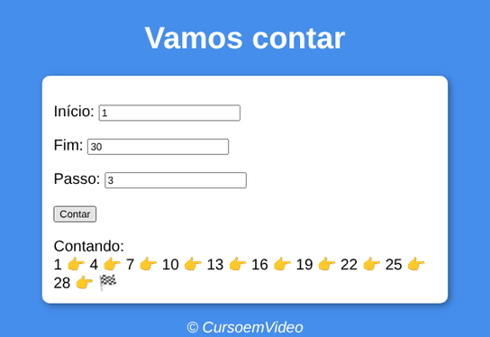
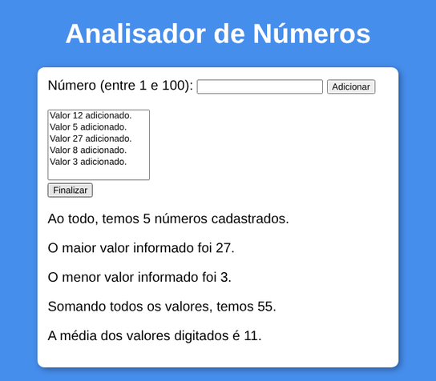

# JavaScript Studies

My JavaScript studies in two parts: the exercises from the JavaScript course by [Curso em Vídeo](https://www.cursoemvideo.com/), taught by Gustavo Guanabara, and a follow-up I did on my own after it, covering scope, functions, classes, modules, asynchronous code, array methods and the DOM.

The code, comments and pages are in Brazilian Portuguese.


## Screenshots

Three course exercises in use:

| Age checker (015) | Counter (016) | Number analyzer (018) |
|---|---|---|
|  |  |  |

## Contents

### Course ([`curso-em-video`](curso-em-video))

Folders follow the course lessons (`aulaNN`). Exercises from the class are numbered `ex001` to `ex018`; the `aulaNNex` folders hold the larger exercises with their own HTML, CSS and script.

| Lessons | Topic | Exercises |
|---|---|---|
| 04 to 06 | first scripts, variables and data types | 001 to 004 |
| 09 and 10 | first steps with the DOM and DOM events | 005 to 007 |
| 11 and 12 | conditions, nested conditions and `switch` | 008 to 015 |
| 13 and 14 | `while`, `do while` and `for` loops | 016 and 017 |
| 15 | arrays | |
| 16 | functions | 018 |
| 17 | objects | |

[`desafios/D001.html`](curso-em-video/desafios/D001.html) is the course challenge on conditions (a nationality checker).

### Follow-up ([`advanced-topics`](advanced-topics))

Seven lessons I put together after the course, with 36 exercises and 40 challenges numbered across all of them.

| Lesson | Topic | Exercises | Challenges |
|---|---|---|---|
| [`aula01`](advanced-topics/aula01) | `var`, `let` and `const`, scope and hoisting | 01 to 03 | 01 to 03 |
| [`aula02`](advanced-topics/aula02) | arrow functions, `setTimeout` and callbacks | 04 to 08 | 04 to 12 |
| [`aula03`](advanced-topics/aula03) | objects, constructor functions, classes and private fields | 09 to 24 | 13 to 22 |
| [`aula04`](advanced-topics/aula04) | modules with `import`/`export` and `require` | 25 and 26 | 23 to 26 |
| [`aula05`](advanced-topics/aula05) | callbacks, promises and `async`/`await` | 27 to 30 | 27 to 31 |
| [`aula06`](advanced-topics/aula06) | array methods such as `find`, `some` and `every` | 31 to 35 | 32 to 36 |
| [`aula07`](advanced-topics/aula07) | selecting elements, changing the page and handling events | 36 | 37 to 40 |

## Running

The pages run in any browser: open the `.html` file, or the `modelo.html` inside an exercise folder. The scripts without a page run with Node.js:

```bash
node advanced-topics/aula05/exercicios/ex28.js
```

## License

My code is released under the [MIT License](LICENSE). The exercise statements, page templates and images from the course belong to Curso em Vídeo.

## Author

Pedro Ross. [GitHub](https://github.com/PedroRossZny) | [LinkedIn](https://www.linkedin.com/in/pedro-ross)
